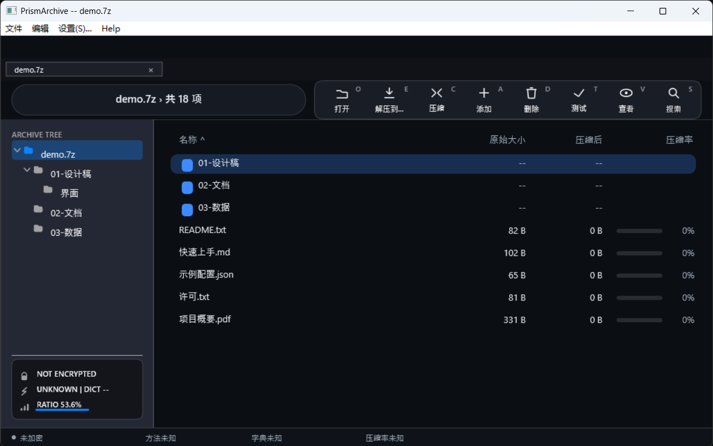
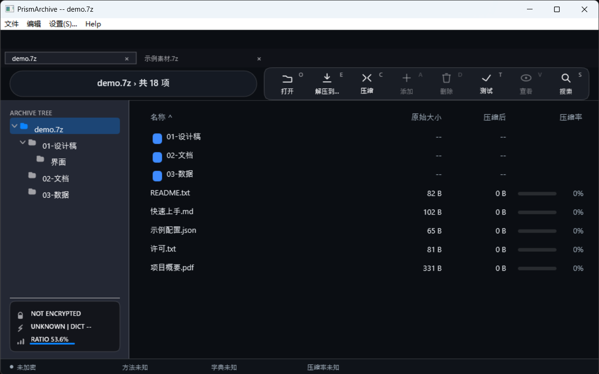
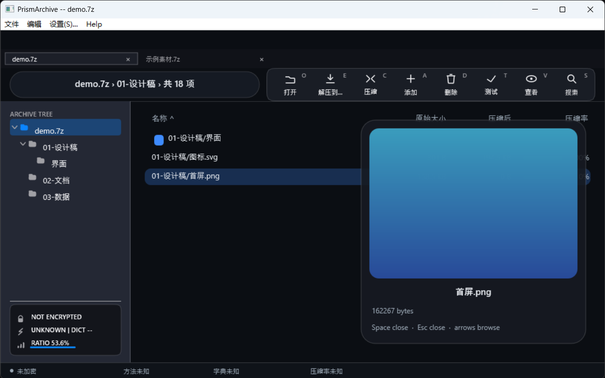
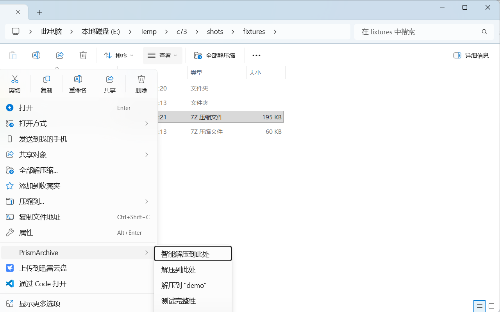

# PrismArchive

**把 7-Zip 的引擎装进一个 Windows 11 的外壳：双击就看，右键就解，键盘优先。**

PrismArchive 是一个 Windows 11 x64 归档管理器：引擎用 7-Zip 的 `7z.dll`（**发布包里带**，也支持运行时到机器上找，见 [ADR-007](docs/ADR.md)），
界面、交互与文件关联都是本仓库自己的实现。当前版本 **0.1.0（开发版）**，MIT 许可。
已经画出来但还没接线的入口，统一列在 [docs/USAGE.md](docs/USAGE.md#本版本的边界)。

装完最常见的问题是「右键没有菜单」。它不是安装失败，是 Windows 11 的菜单分层，
见下文 [为什么右键在「显示更多选项」里](#为什么右键在显示更多选项里)。

## 截图

四张图都是真机截图（1280×800，规范见 [docs/assets/README.md](docs/assets/README.md)）：

| 主界面 | 多标签 |
|---|---|
|  |  |

| 空格预览 | 右键菜单 |
|---|---|
|  |  |
## 安装（三步，免管理员）

1. 从 [Releases](https://github.com/xueweijian/prism-archive/releases) 下载
   `PrismArchive-0.1.0-win-x64.zip`，解压到任意目录（例如 `D:\Apps\PrismArchive`）。
2. **不需要再装 7-Zip**：包里带 `7z.dll`。若你想用机器上已有的引擎，安装器会自动优先用它（见下文 7z.dll 解析阶梯）。
3. 在解压目录执行安装脚本：

```pwsh
pwsh -NoProfile -ExecutionPolicy Bypass -File .\install.ps1
```

成功的最后一行是这样（`engine=` 后面就是你机器上的 `7z.dll`）：

```text
INSTALL: OK C:\...\PrismArchive (22 associations, engine=E:\DevTools\7-Zip\7z.dll)
```

脚本从**自己所在目录**取 payload（zip 解压后 `PrismArchive.exe`、`install.ps1`、`uninstall.ps1`、
`register-static-verbs.ps1` 同级），再退回构建目录；所以解压到哪都能直接跑。

安装器只写 `HKCU` 和 `%LOCALAPPDATA%\PrismArchive`，不弹 UAC、不写机器级关联。
不想装到默认位置加 `-InstallDir`；只想带走、不写注册表加 `-Portable`：

```pwsh
pwsh -NoProfile -ExecutionPolicy Bypass -File .\install.ps1 -InstallDir D:\Apps\PrismArchive
pwsh -NoProfile -ExecutionPolicy Bypass -File .\install.ps1 -Portable -SourceDir . -InstallDir .
```

先看它打算写什么，再真装（`-DryRun` 不落盘、不写注册表）：

```pwsh
pwsh -NoProfile -ExecutionPolicy Bypass -File .\install.ps1 -DryRun
```

## 三条最常见的用法

**1. 双击打开。** 安装器把 22 个扩展指到 PrismArchive。如果双击后打开的是别的程序，
说明这个扩展被 Windows 的「用户选择」钉住了——那不是安装器能改的，见
[docs/TROUBLESHOOTING.md](docs/TROUBLESHOOTING.md#关联被别的软件锁定双击还是打开别的程序)。

**2. 右键解压。** 资源管理器里右键归档 →「显示更多选项」→「用 PrismArchive 解压到此处」。
这条动词由安装器写进注册表（`HKCU\Software\Classes\*\shell\PrismArchiveExtract`），
命令行是 `PrismArchive.exe --extract-here "<归档路径>"`。

**3. 右键压缩。** 这一步**安装器不做**：压缩类动词来自经典右键菜单处理器
（`PrismShellExtClassic.dll`），需要单独注册一次（仍然免管理员）：

```pwsh
pwsh -NoProfile -ExecutionPolicy Bypass -File .\tools\msix\register-classic.ps1 -DllPath "$env:LOCALAPPDATA\PrismArchive\PrismShellExtClassic.dll"
```

注册后右键非归档文件 →「显示更多选项」里会出现「压缩为 .7z 归档」「压缩为 .zip 归档」。
不注册也有等价入口：应用内 **文件 → 压缩为 .7z…**，或命令行 `--compress-7z`。

## 右键菜单：两层，两种装法

Windows 11 把右键菜单拆成两层，我们的入口在**两层都能出现**，但代价不同：

| 层 | 怎么进去 | 要什么 | 看到什么 |
|---|---|---|---|
| **经典菜单**（「显示更多选项」/ `Shift+F10`） | `INSTALL.cmd` 自动写 `HKCU\Software\Classes\*\shell\…` | 什么都不用 | 「用 PrismArchive 解压到此处 / 打开」 |
| **一级菜单**（新式） | 注册稀疏包：`tools\msix\enable-dev-mode-and-register.cmd` | **一次管理员**（开开发者模式），**不需要证书、不需要付费** | 「PrismArchive >」子菜单：智能解压到此处 / 解压到此处 / 解压到 "x" / 测试完整性 |

两条路互不冲突。想验证经典层注册好了没：

```pwsh
$cls = [Microsoft.Win32.Registry]::CurrentUser.OpenSubKey('Software\Classes')
'open    = ' + [bool]$cls.OpenSubKey('*\shell\PrismArchiveOpen')
'extract = ' + [bool]$cls.OpenSubKey('*\shell\PrismArchiveExtract')
```

两行都是 `True` 就说明在经典层；去「显示更多选项」里就能看到。
想把入口搬进一级菜单，跑一次 `enable-dev-mode-and-register.cmd`（会弹一次 UAC），
细节与三种免费方案见 [docs/MSIX-SIGNING.md](docs/MSIX-SIGNING.md)。
## 7z.dll 依赖

**发布包自带 `7z.dll`**，解压即用，不需要额外安装 7-Zip（取舍见 [ADR-007](docs/ADR.md)：包体多 ~1.5 MB，
随包附带 7-Zip 许可证正文与源码地址）。

如果你希望用机器上已有的引擎（例如想升级 7-Zip 而不重装），解析阶梯会优先找它：

1. 用户环境变量 `PRISM_7Z_DLL` 指向 `7z.dll` 的**完整路径**；
2. `PrismArchive.exe` 同目录的 `7z.dll`（便携场景，也是安装器部署的位置）；
3. 7-Zip 自己的 `InstallDir`（HKLM / WOW6432Node / HKCU）；
4. `%LOCALAPPDATA%\Programs\7-Zip`、scoop 等常见位置；
5. 最后才回落到 `Program Files\7-Zip`。

## 命令行

无窗口动词（右键菜单调用的就是这些），退出码即裁决：

| 命令 | 作用 | 退出码 |
|---|---|---|
| `PrismArchive.exe "<归档>"` | 打开界面 | 0 |
| `--extract-here "<归档>"` | 解压到归档所在目录 | 0 成功 / 1 失败 / 2 缺参数 |
| `--extract-sub "<归档>"` | 解压到以归档名命名的子目录 | 同上 |
| `--test "<归档>"` | 只校验、不开窗；stderr 打印 `verify ok=...` | 0 通过 / 1 失败 |
| `--compress-7z "<文件或目录>" ...` | 压缩成 `.7z` | 0 成功 / 1 失败 / 2 缺参数 |
| `--compress-zip "<文件或目录>" ...` | 压缩成 `.zip` | 同上 |
| `--smart-extract` / `--smart-extract-each` | 智能解压（单个 / 各归各的目录） | 同上 |

不认识的参数不会开对话框卡住调用方，而是向 stderr 说明并退出 2：

```text
verb refused: unsupported flag --nope; supported: --smart-extract --extract-here --extract-sub --test --compress-here --compress-7z --compress-zip --smart-extract-each
```

加密归档的动词会先弹密码框（每次调用都要人工输入一次），批处理脚本里请注意这一点。

## 卸载

```pwsh
pwsh -NoProfile -ExecutionPolicy Bypass -File "$env:LOCALAPPDATA\PrismArchive\uninstall.ps1"
```

或者 **设置 → 应用 → 已安装的应用 → PrismArchive → 卸载**。卸载会删除安装目录、卸载项、
`PrismArchive.*` ProgID 与右键动词，并把每个扩展恢复成安装前的处理器（逐键比对）。
重复卸载打印 `UNINSTALL: already clean`，不是错误。

## 文档

- 装完之后怎么用（动作岛、快捷键、拖放、密码、归档内编辑）：[docs/USAGE.md](docs/USAGE.md)
- 出问题先查这里（右键没有、7z.dll 找不到、乱码、被占用、关联被锁）：[docs/TROUBLESHOOTING.md](docs/TROUBLESHOOTING.md)
- 截图规范与拍摄清单：[docs/assets/README.md](docs/assets/README.md)
- 从源码构建 / 打包 / 校验 / 发布：[docs/RELEASE.md](docs/RELEASE.md)
- 界面规格：[docs/DESIGN.md](docs/DESIGN.md) · 跨层契约：[docs/CONTRACTS.md](docs/CONTRACTS.md)
- 安装器细节（注册表逐键、`-Verify` 的三种结局）：[Installer/README.md](Installer/README.md)
- 进度与路线：[docs/PROGRESS.md](docs/PROGRESS.md) · [ROADMAP.md](ROADMAP.md)

## 许可

MIT（见 [LICENSE](LICENSE)）。7-Zip 引擎通过 `LoadLibraryW` 运行时加载，遵循其自身的 LGPL；
UI/交互层与引擎保持 MIT 干净隔离。
