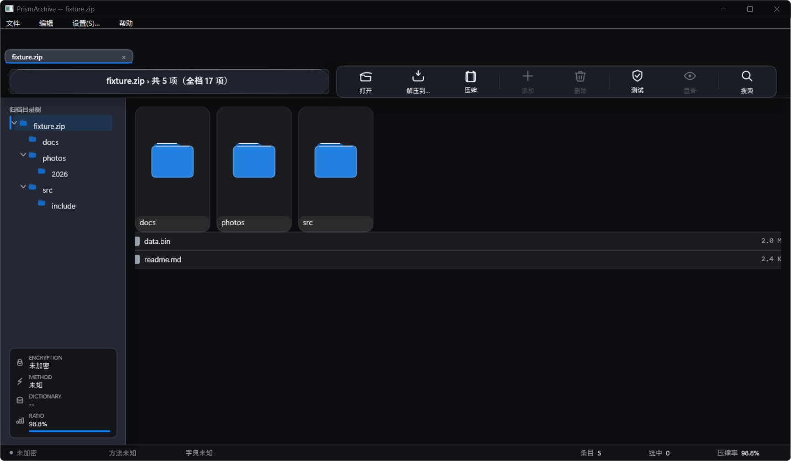
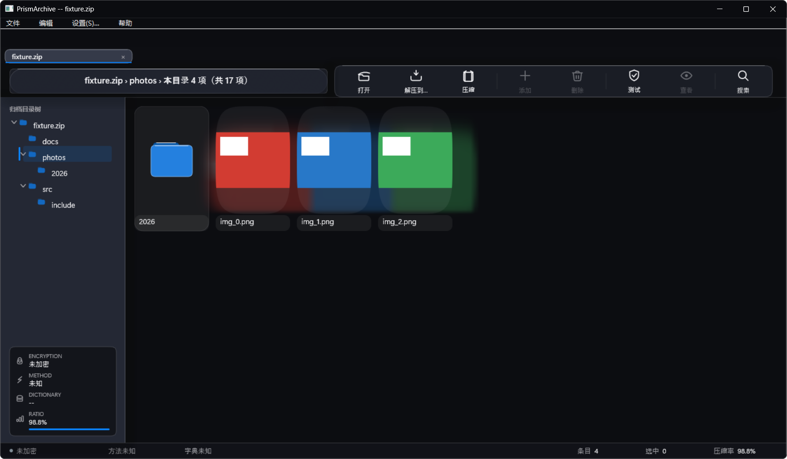
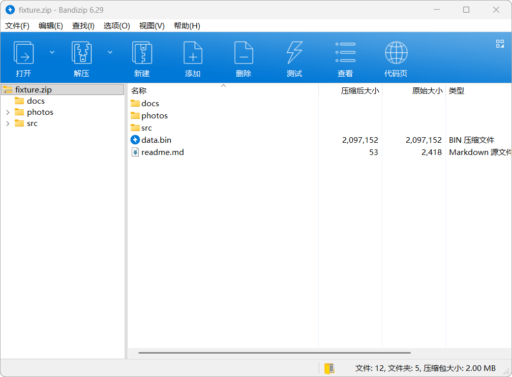

# UI 实测对照：PrismArchive vs Bandizip 6.29

> 2026-11-07。方法：用 `agent-desktop` 对**同一个测试包**（`fixture.zip`，12 文件 / 5 目录 / 6 张 PNG / 2MB 二进制）
> 分别做一次完整交互巡游，截图 + 无障碍树 + 像素测量。**结论只来自跑出来的东西**，不来自注释或设计文档。

## 0. 一句话结论

PrismArchive 现在的问题**不是"做得不够漂亮"，而是"默认状态选错了"**：
打开归档时它给你**网格**，Bandizip 给你**列表**；它把**文件夹图标染成蓝色**，Bandizip 是**金黄**；
它只显示**名称 + 大小**，Bandizip 有**四列**（名称/压缩后大小/原始大小/类型）；
它的工具栏是**浮动玻璃岛**，Bandizip 是**贴边实心蓝条**。

再加上一条**真缺陷**：开启折射时，每张照片图块周围糊出一圈**彩色光晕**（下面有 A/B 证据）。

## 1. 方法与证据

| 项 | 值 |
|---|---|
| 工具 | `agent-desktop`（`snapshot -i` / `click` / `screenshot --window-id`） |
| 测试包 | `E:\Temp\uicheck\fixture.zip`（12 文件 / 5 目录 / 6 PNG / 2MB bin） |
| PrismArchive | 本机安装版（`main` + PR #135 的对比度修复），1400×900，zh-CN |
| Bandizip | 6.29（`C:\Program Files\Bandizip`），同一 zip |
| 截图 | `E:\Temp\uicheck\tour-*.png`、`bz-01-open.png` |

## 2. PrismArchive 实测

### 2.1 打开归档（默认网格）

观察：
- 默认**网格**：文件夹是 3 张大卡片，文件是 2 行列表 —— **同一屏两种形态混排**。
- 文件夹卡片很大（165×280），内容只有一个蓝色文件夹图标 + 名字，**留白过多**。
- 左下信息卡四组（ENCRYPTION / METHOD / DICTIONARY / RATIO），RATIO 条在百分比下方（C105 已修）。
- 状态栏：未加密 / 方法未知 / 字典未知 / 条目 5 / 选中 0 / 压缩率 98.8%。

### 2.2 进入 photos 目录（发现 P0 缺陷）

**缺陷 A（P0）：照片图块周围出现彩色光晕。**

A/B 证据（同一台机器、同一场景，只切 `appearance.backdropRefraction`）：

| 折射 | 结果 | 截图 |
|---|---|---|
| 开 | 每张照片周围一圈模糊彩色光晕，图块边缘发虚 | `audit-prism-photos.png` |
| 关 | 图块干净、圆角裁剪正确、无光晕 | `audit-prism-norefr.png` |

像素测量（红色照片）：包围盒 `(475,291)-(637,413)` = **163×123**，与图块宽度 163 一致 ——
**图块本身没有溢出**，光晕来自**内容带的玻璃层把缩略图模糊进了背景**。

根因链：C110 为了让 C77-1（"这层真的在折射内容"，`over8 > 20000 px`）保持绿，
决定 ghost 里**保留归档像素（缩略图）**。于是照片被 1/8 采样 + 模糊，变成图块周围的彩色雾。

> **一条断言在逼出视觉缺陷。** 正确的做法是把 C77-1 重新定义为"这层折射的是页面背景（画布 + 面板）"，
> 而不是"必须包含条目像素"。

### 2.3 交互巡游结果

| 操作 | 结果 | 判定 |
|---|---|---|
| 点树里 `photos` | 正确进入，面包屑变 `fixture.zip › photos › 本目录 4 项（共 17 项）` | ✅ |
| 点树里 `2026` | 截图与上一步**字节相同** —— 未导航 | ⚠️ 待查 |
| 点面包屑根 | 截图与上一步**字节相同** —— 未导航 | ⚠️ 待查 |
| 双击 `photos` 图块 | 进入 photos | ✅ |
| 选中 `readme.md` + 点"查看" | **用外部程序打开**临时解出的文件，状态栏显示 `已打开：...\PrismArchive-Open\open-...\readme.md` | ✅ 与 Bandizip 的"查看"语义一致 |
| 点 `设置(S)...` | **没有出现设置窗口**（窗口列表仍只有主窗口） | ❌ P1 |

> 无障碍树里，面包屑是**一个整体 `listbox` 节点**（名字是整串文字），不是分段可点。
> C93 让它在**像素上**可点，但**无障碍/自动化层面不可分段**。真实用户点得到，读屏和 agent 点不到。

## 3. Bandizip 6.29 实测

拆解它的设计语言：

| 部位 | Bandizip 的做法 |
|---|---|
| 标题栏 | 系统标题栏 + 程序图标 + `文件名 - Bandizip 6.29` |
| 菜单栏 | `文件(F) 编辑(E) 查找(I) 选项(O) 视图(V) 帮助(H)` —— **带助记符** |
| 工具栏 | **贴边实心蓝条**（约 #1B8FE8），8 个 32px 线性图标 + 中文标签，`打开`/`解压` 带**下拉箭头** |
| 左栏 | 树，**只有归档节点有图标**，子目录纯文字 + 展开器，宽度约 240 |
| 右栏 | **列表**，四列：`名称` / `压缩后大小` / `原始大小` / `类型`，带列标题与排序箭头 |
| 文件夹图标 | **金黄色**经典文件夹（实心、带 tab） |
| 文件图标 | **按类型**：`.bin` 是圆形磁盘图标，`.md` 是文档图标 |
| 状态栏 | `文件: 12, 文件夹: 5, 压缩包大小: 2.00 MB` + 归档图标 |
| 滚动条 | 列表底部有水平滚动条 |
| 信息卡 | **没有** |

## 4. 逐项对比（"为什么不像"）

| # | 维度 | Bandizip | PrismArchive | 影响 |
|---|---|---|---|---|
| 1 | **默认视图** | 列表（四列） | **网格**（大卡片） | ★★★ 打开归档第一眼就不同 |
| 2 | **列结构** | 名称/压缩后大小/原始大小/类型 | 名称/大小（两列） | ★★★ 看不到"原始大小"和"类型" |
| 3 | **文件夹图标** | 金黄实心 | **蓝色圆角方块** | ★★ 色彩语言完全不同 |
| 4 | **工具栏** | 贴边实心蓝条 + 下拉箭头 | 浮动玻璃岛，无下拉 | ★★ 视觉重量与位置不同 |
| 5 | **左侧树图标** | 只有归档有图标 | 每个节点都有蓝色文件夹 | ★ 噪声更多 |
| 6 | **助记符** | 有 `(F)(E)(I)` | 无（C100 删掉了） | ★ 键盘用户少了线索 |
| 7 | **状态栏信息** | 文件数/文件夹数/压缩包大小 | 加密/方法/字典/条目/选中/压缩率 | ★ 关注点不同 |
| 8 | **信息卡** | 无 | 有（左下四组） | ○ 我们的特色，不算错 |
| 9 | **光晕缺陷** | 无 | **有**（折射开时） | ★★★ 明显不干净 |

## 5. 我建议的修复顺序

### P0（影响"像不像"，且能立刻验证）

1. **修光晕**：ghost 只承载页面背景（画布 + 面板），不含条目像素；
   同时把 `c77` 的 C77-1 重新定义为"折射画布/面板"，而不是"必须含条目像素"。
   **断言**：照片图块外侧 8px 环带内的色度方差 ≤ 阈值（今天光晕让它高一个量级）。
2. **默认视图改列表**，并补齐四列：名称 / 压缩后大小 / 原始大小 / 类型。
   **断言**：`scene.listMode` 默认 true；四个列标题的矩形都非空且不重叠。

### P1（视觉语言对齐）

3. **文件夹图标改金黄**（或提供主题色 token），并给文件**按类型着色/图标**（至少区分 文档/图片/二进制/代码）。
4. **工具栏改为贴边条**（或提供"浮动/贴边"两种密度），`打开`/`解压` 加下拉箭头。
5. **恢复菜单助记符**（C100 删掉的是"图标上的单字母角标"，不是菜单助记符——这两件事要分开）。
6. **修设置对话框不出现**。

### P2（细节）

7. 左侧树**只给归档节点图标**，子目录纯文字（降低噪声）。
8. 状态栏改成 `文件: N, 文件夹: M, 压缩包大小: X`（或提供两种状态栏密度）。
9. 面包屑在无障碍树里**分段暴露**（每段一个节点），让读屏/agent 可点。

## 6. 还没测的

- 解压流程（进度、冲突、完成）在两边的手感；
- 拖放（从资源管理器拖入、从归档拖出）；
- 大归档（1 万条目）的滚动与搜索；
- 键盘导航（Tab 顺序、方向键、Enter/Space）。

## 7. 证据文件

| 文件 | 内容 |
|---|---|
| `audit-prism-open.png` | PrismArchive 打开 fixture.zip（默认网格） |
| `audit-prism-photos.png` | 进入 photos（光晕缺陷） |
| `audit-prism-norefr.png` | 同一场景关闭折射（对照，干净） |
| `audit-bandizip.png` | Bandizip 6.29 打开同一 zip |
