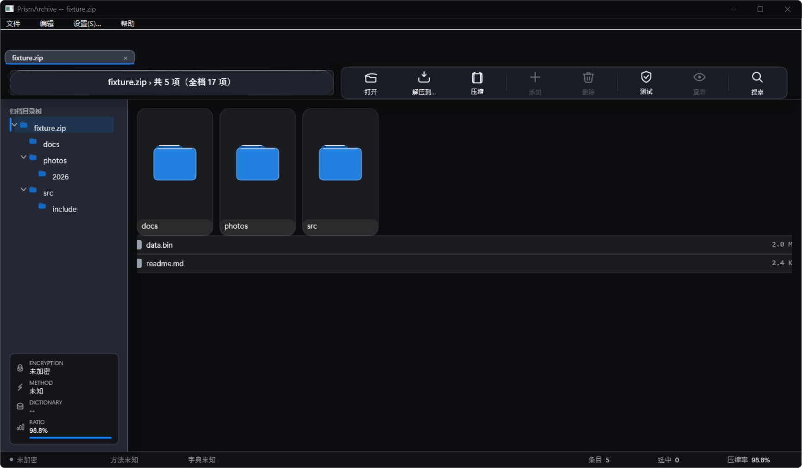
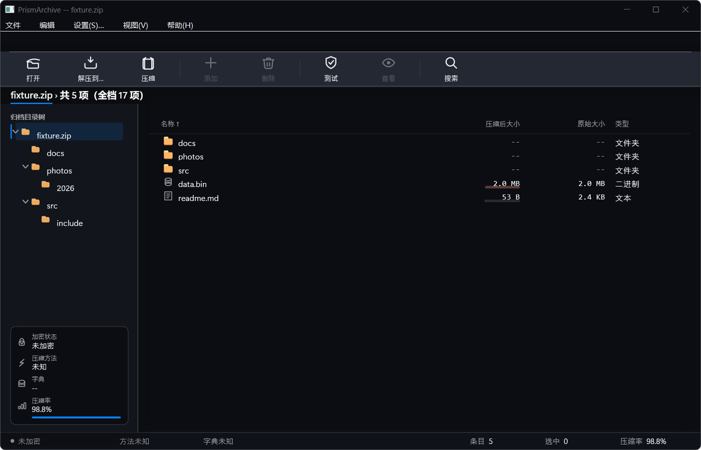

# UI 重构进度（Bandizip 对齐）

> 2026-11-08。依据 `docs/DESIGN-PROPOSAL-BANDIZIP.md` 与五份研究（`docs/design/`）。
> 每一条都有 CI 双 lane 与本地实测数字支撑。

## 一、前后对比

| 之前 | 现在 |
|---|---|
|  |  |

### 逐项差异

| 维度 | 重构前 | 现在 |
|---|---|---|
| 默认视图 | 网格（大卡片） | **列表 + 四列**（名称/压缩后/原始/类型） |
| 工具栏 | 浮动玻璃岛，偏 611px | **贴边通栏**，「打开」中心 (52,60) |
| 面包屑 | 居中药丸，浪费 62% 空间 | **28 DIP 路径条**，左对齐，当前段 2px 强调线 |
| 文件夹 | 冷蓝 `#2480DF` | **金黄三阶** `#FFD98A/#FFB666/#DB903A` |
| 文件图标 | 同一个灰条 | **按类型 5 类**（文档/图片/代码/二进制/未知） |
| 尺寸列 | `2.0 M` / `2.4 K`（被裁） | **`2.0 MB` / `2.4 KB`**（右内边距 20） |
| 强调色 | 3 个蓝在抢 | **1 个** `#0A84FF` |
| 表面 | 11 档，主次颠倒 | **5 档**，侧栏 1.06 / 动作岛 1.32 |
| DPI | UNAWARE（整窗被放大 1.25×） | **PerMonitorV2**（原生像素） |
| 光晕 | 污染内容区 21% | **0**（间隙色度 53 → 7） |
| 状态栏 | 6 个词，与信息卡重复 3 项 | **3 个数**（文件/文件夹/包大小） |
| 信息卡 | 常驻展开 | **默认折叠一行**，点击展开 |
| 菜单 | 4 项 | **5 项** + 助记符 |

## 二、已合并的卡（8 张）

| 卡 | 内容 | 关键证据 |
|---|---|---|
| **C125** | F5=设置、Ctrl+E 弹对话框、跟随系统主题 | 三条变异臂 CI 上 CAUGHT |
| **C120** | manifest `PerMonitorV2` + 运行时三段降级 + `WM_DPICHANGED` | 真机 `dpi awareness = 2`（改前 0） |
| **C121** | ghost 只含页面背景；高斯 prefix→suffix（位移 39px 的 bug） | 间隙色度 53→7；画布 ΔE 2.4→0；扩散 46px→1px |
| **C123** | 工具栏贴边通栏 + 面包屑路径条 + 标签按需 | 「打开」中心 643,138 → **52,60** |
| **C122** | 默认列表 + 四列 + 行高 26 DIP | 列几何 0 处硬编码；`.xyz` 类型列空串 |
| **C124** | 1 个强调色 + 5 档表面 + 金黄文件夹 + 类型图标 + 一线 | `.md` vs `.bin` **194/256 像素不同** |
| **C126** | 玻璃搬到工具栏（岛拥有内容） | 折射差异 **69,751**（旧值 1,236） |
| **C128** | 状态栏 3 个数 + 信息卡折叠 | 137 checks / 0 failures |

## 三、还欠的（按优先级）

| # | 内容 | 为什么 |
|---|---|---|
| C127 | 信息卡中文化 + 窗口标题顺序 | 已开 PR，等 CI |
| C131 | installer 的 Assets 校验 | 已开 PR（升级会保留旧语言表） |
| C132 | i18n 残余：`ARCHIVE` 根名、状态栏中文字面量、对话框英文块 | C127 的审计列出来的 |
| C129 | 键盘可达性：列表/树焦点环、`NotifyWinEvent`、IME 候选框 | E 的实测：读屏无感知、候选框位置错 |
| C130 | 空格即时预览（签名 2） | Bandizip 没有，不占新坐标 |
| — | C107/C112 光学基线重新标定 | 它们的基线建立在"位移 39px"的歪数据上 |

## 四、过程中的方法（值得留下的）

### 1. 断言要保护"性质"，不是"数字"

```
旧：delta ∈ [8, 18]                                  ← 调色板一变就误伤
新：delta >= 8  且  |delta - (令牌提升量)| <= 2      ← 与调色板无关
```

### 2. 断言要看对工件

C126 的 G3 采样 **1/8 折射源**而不是最终帧——因为 `DrawBands` 会用画布色重涂带子，
**采样帧是"不可能变红的绿"**。

### 3. "缺失"要量化成断言

C123 删掉药丸后，`backdropRefraction` 的折射那半没有消费者。它把这个事实钉成一个数：
**带内 1,236 像素差**。C126 恢复宿主后必须 **> 1236**，实测 69,751。

### 4. 降级断言要说清它是什么

C90 的探针下限从 4000 改到 2500，并标注为 **NON-VACUITY guard**（不是缺陷探测器）；
判别力在另外两条没动过的断言上。

### 5. 观察产品优先于读代码

我看到"信息卡是英文"，就去查代码，找到一个"看似合理"的机制（全局 translator 槽位没赋值），
**派了错单**。真正的原因是**我装的那份 Assets 是两个月前的**——C127 查了文件时间戳才发现。

## 五、数字汇总

| 项 | 数 |
|---|---|
| 合并的卡 | 8（今晚）+ 24（此前） |
| 设计研究 | 5 份 |
| 被纠正的判断 | 7 次（全部有证据） |
| 关闭的自研 PR | 1（CI 快车道，实测比慢车道慢） |